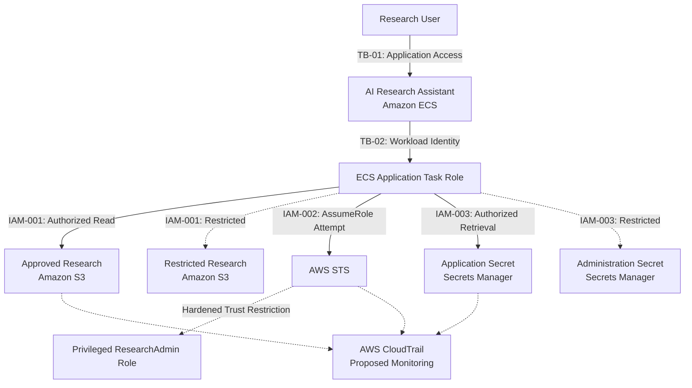

# Cloud Identity Security Architecture

## System Context and Trust Boundaries

## Security Controls

- **IAM-001:** Resource-scoped S3 permissions prevent modeled unauthorized access to restricted research datasets.
- **IAM-002:** Caller permissions and target-role trust restrictions prevent modeled unauthorized privileged-role assumption.
- **IAM-003:** Resource-scoped Secrets Manager permissions prevent modeled retrieval of unrelated secrets.

Solid arrows represent intended or permitted relationships.

Dashed arrows represent restricted paths or proposed monitoring relationships, as indicated by their labels.

## Implementation Status

The IAM policies and authorization tests are implemented in a synthetic offline lab.

The ECS application, AWS resources, STS operations, and CloudTrail monitoring are architectural representations only.

No live AWS deployment or production enforcement has been validated.